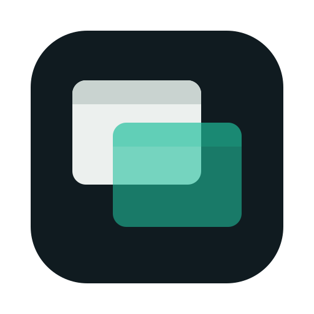

<p align="center"></p>

# Seethru

A small, open-source menu bar app for macOS that makes **any app's windows see-through**, with a slider per app or
per window, global hotkeys, and per-app memory. Everything runs on your Mac: no network, no telemetry, no accounts.

> Status: v0.1, early. Capture and overlay are verified on macOS 26; the full "hide the original" path still needs
> confirmation on more setups (see [docs/FEASIBILITY.md](docs/FEASIBILITY.md)). Read the limitations below.

## What it does

- **Peek**: one button (or the hotkey) drops every transparent window to 20% so you can look at what is behind them, and brings your values back on the second press.
- Menu bar list of apps and their windows with an opacity slider (10–100%) per window and per app, and **Reset all**.
- Global hotkeys (no extra permission): more/less transparent for the frontmost window, reset, and **Peek**
  (all managed windows drop to 20% until you toggle it off).
- "Remember for this app": new windows of that app open already transparent. "Never touch this app" exclude list.
- Optional per app: always on top, click-through (needs Accessibility).
- Open at login.

| Hotkey | Action |
|---|---|
| ⌃⌥⌘↓ / ⌃⌥⌘↑ | more transparent / more opaque (frontmost window) |
| ⌃⌥⌘0 | reset frontmost window |
| ⌃⌥⌘P | peek |

## How it works, honestly

macOS does not let one app change another app's window opacity. The direct route (private SkyLight `SLSSetWindowAlpha`)
returns success but is silently ignored for other apps' windows when System Integrity Protection is on, which we
measured (see FEASIBILITY). So Seethru's default **Mirror** backend leaves the window where it is and stacks two
click-through panels on top of it:

1. a backdrop that shows the screen as it looks without that window (ScreenCaptureKit display capture, window excluded),
2. a live copy of the window drawn at your opacity.

The result is the window blended with what is behind it, while clicks, scrolling and typing still go to the real window.
Only **Screen Recording** permission is needed. Click-through and always-on-top work differently: the real window is moved
off-screen with the Accessibility API and the copy is shown instead, which also needs **Accessibility**.

Consequences you should know about:

- Slight latency: the backdrop and the copy are a frame or two behind. When you click a window macOS raises it above the
  panels for a moment before Seethru puts them back (a brief flicker).
- Some content (DRM video, secure fields) may not be captured. Full-screen windows are not supported.
- Two transparent windows that overlap show each other opaque.
- It relies on undocumented behaviour (`_AXUIElementGetWindow` for click-through / always-on-top), so **a macOS
  update can break it**. All of it is isolated in `Sources/PrivateAPI` and fails with a message, not a crash.
- Not sandboxed (impossible with Accessibility), so it cannot be on the Mac App Store.
- With a crowded menu bar macOS may hide the icon. Open Seethru again from Finder/Spotlight to get a regular window.

## Install

Download `Seethru-<version>.zip` from Releases, unzip, move to Applications. Releases are not notarized, so the first time:
right-click → Open. Then grant Screen Recording in the welcome window (Accessibility only for click-through) and relaunch.

Build it yourself (Command Line Tools are enough, Xcode is not required):

```bash
scripts/run.sh
```

Permissions follow the code signature. Ad-hoc builds lose them on every rebuild; for development sign with a stable
identity: `SIGN_IDENTITY="Apple Development: Your Name (TEAMID)" scripts/run.sh`.

## Repository

[docs/ARCHITECTURE.md](docs/ARCHITECTURE.md) · [docs/FEASIBILITY.md](docs/FEASIBILITY.md) · [docs/QA.md](docs/QA.md) ·
[CONTRIBUTING.md](CONTRIBUTING.md) · MIT licensed. The logo is generated by `scripts/make_icon.swift`.
